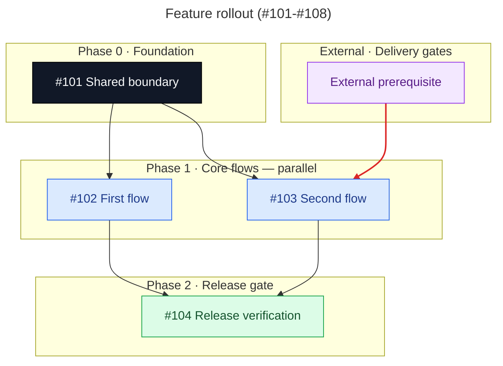

# Beautiful DAG

Turn the dependency source of truth into a diagram that explains both execution order and rollout shape. Preserve graph semantics; use styling to reveal them.

## Workflow

1. **Reconstruct the graph.** Collect every in-scope node, its short title, every direct dependency edge, and any external or human gate. Prefer native issue dependencies, manifests, or explicit blocker lists over prose. Finish when each node and direct edge has one authoritative source.

2. **Prove the graph.** Check for missing nodes, duplicate edges, cycles, and contradictions between prose and native dependencies. Resolve discrepancies before drawing. If the task only authorizes presentation changes, report semantic discrepancies without rewriting them. Finish when the edge list is acyclic and internally consistent.

3. **Layer phases.** Put zero-dependency internal nodes in Phase 0. Place each later node in the earliest phase after all internal predecessors it actually needs. Group independent nodes in the same phase and label it `— parallel`. Put external tickets and human actions in a distinct `External · … gates` subgraph instead of pretending they belong to the internal rollout. Finish when every internal node appears in exactly one phase.

4. **Write the visual grammar.** Use `flowchart TD`, a quoted Mermaid title, ordered subgraphs, compact labels, and ` ` only where it improves node width. Use stable IDs such as `T204` for internal tickets and `S208` or `G1` for external gates. Collapse repeated edges with `A --> B & C` when readability improves. Finish when the diagram is legible without the surrounding prose.

5. **Apply semantic styling.** Use this palette consistently:

   - Foundation: `fill:#111827,color:#f9fafb,stroke:#000000`
   - Core measurement or flow: `fill:#dbeafe,stroke:#2563eb,color:#1e3a8a`
   - Expansion or activation: `fill:#ffedd5,stroke:#ea580c,color:#7c2d12`
   - Release gate: `fill:#dcfce7,stroke:#16a34a,color:#14532d`
   - External gate: `fill:#f3e8ff,stroke:#9333ea,color:#581c87`

   Assign every node exactly one class. Adapt phase names to the domain while keeping color meaning stable.

6. **Emphasize one meaningful path.** Highlight only edges that communicate a real execution constraint: the critical path, cross-epic gates, or human release gates. Use `stroke:#dc2626,stroke-width:2px`. Count `linkStyle` indices from zero in declaration order; an expression such as `A --> B & C` creates two consecutive edges. Finish when every highlighted index resolves to the intended edge and no decorative edge is highlighted.

7. **Validate the rendering contract.** Compare the diagram against the source edge list. Confirm every node appears once, every direct edge appears once, no edge was invented for layout, phase order respects all dependencies, compact edge syntax expands correctly, class assignments cover all nodes, and `linkStyle` indices are exact. Keep syntax compatible with GitHub Mermaid. Finish only when every check passes.

8. **Publish surgically.** Return a fenced `mermaid` block unless the user asked for a live update. When editing an existing document or issue, replace only the target diagram and preserve its surrounding prose, ticket links, and dependency data. Read the published block back after mutation.

## Output shape

Use this structure and adapt its nodes, phases, and highlighted edges to the verified graph:

Treat the example as a grammar, not a fixed template. The verified dependency graph decides the phases and edges.
